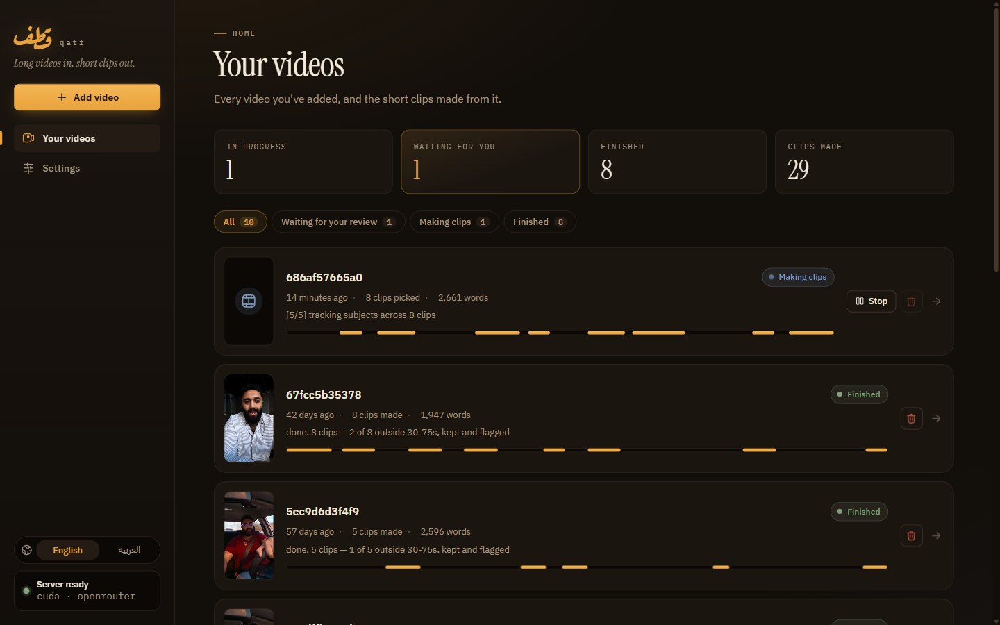
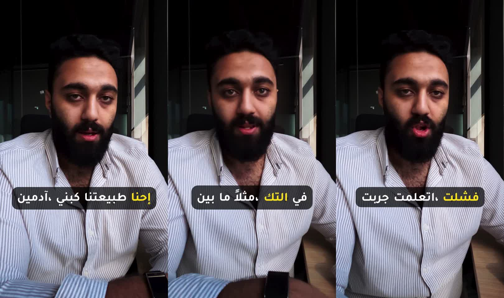
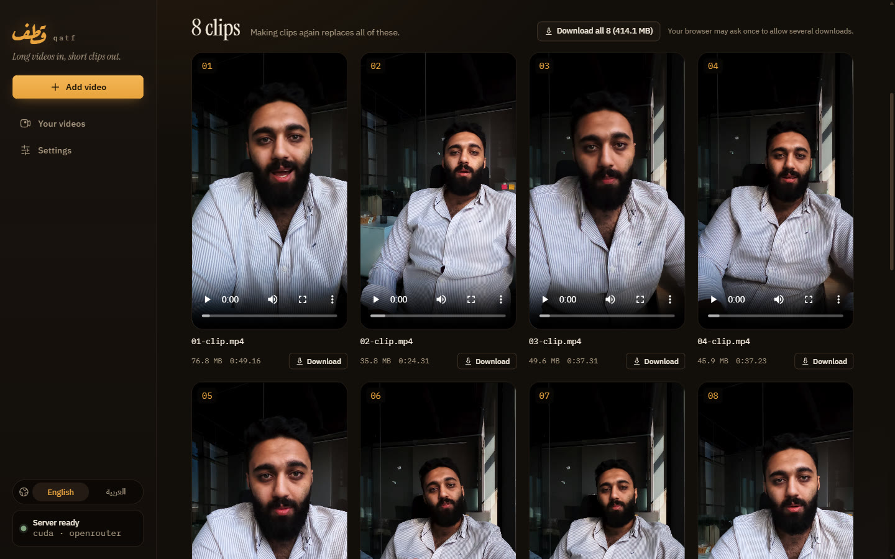
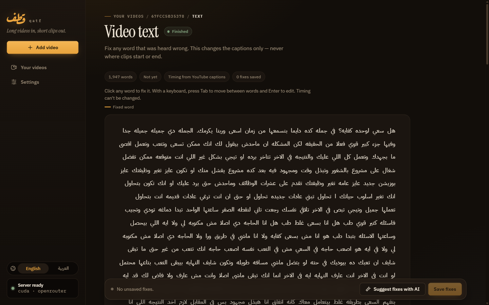

# qatf (قطف)

[](https://github.com/Abdel-RahmanSaied/Qatf/actions/workflows/ci.yml)
[](LICENSE)
[](https://www.python.org/downloads/)
[](CONTRIBUTING.md)

**Turn a long video into vertical short-form clips.** A model picks the moments;
everything about *where* the cuts land is deterministic.

قطف — *to pick, to harvest*.

> **بالعربي:** أداة مفتوحة المصدر بتحوّل الفيديو الطويل لمقاطع قصيرة طولية
> للـ Reels والـ Shorts والـ TikTok. بتفرّغ الكلام، وتختار أحسن اللحظات
> بالذكاء الاصطناعي، وتكتب ترجمة عربي كلمة بكلمة. لسه prototype،
> و[المساهمة مرحّب بيها جدًا](#contributing).



```bash
docker compose up      # web UI on :3000, API on :8000
```

---

## Contents

- [What it does](#what-it-does)
- [What makes it different](#what-makes-it-different)
- [Everything it can do](#everything-it-can-do)
- [Quickstart](#quickstart)
- [The web UI](#the-web-ui)
- [The CLI](#the-cli)
- [The HTTP API](#the-http-api)
- [Configuration](#configuration)
- [Running with a different model](#running-with-a-different-model)
- [Repository layout](#repository-layout)
- [Documentation](#documentation)
- [Testing](#testing)
- [Status](#status-working-prototype)
- [Contributing](#contributing)

---

## What it does

Five stages. Two of them run a model — Whisper hears the words, an LLM picks
the moments — and everything about where a cut lands is deterministic.

```text
0. fetch       a URL → a local file            yt-dlp, on an exact-host allowlist
1. audio       demux (optionally denoise)      ffmpeg
2. transcribe  words with start/end times      faster-whisper — or a caption track  ← model
3. select      which passages are worth it     the configured LLM                   ← model
4. snap        cuts onto real word boundaries  deterministic
5. render      reframe 9:16, burn captions     ffmpeg
```

```text
[1/5] extracting audio (denoising)
[2/5] transcribing with whisper large-v3 on cuda (auto-selected)
      biasing vocabulary (30 terms, whole file)
      detected language: ar (p=1.00)
[3/5] asking anthropic/claude-opus-5 for 8 clips
[4/5] snapped cuts to word boundaries
      03:04-03:53 (49.5s, 0.85)  PHP ماتت؟ الكلام ده بقاله سنين
      08:24-09:14 (50.0s, 0.84)  ما تسلّمش دماغك لأي حد: دوّر بنفسك
      ...
[5/5] rendering 8 clips at 1080x1920 h265 -preset medium
done. 8 clips in reels/
```

---

## What makes it different

**Arabic is a first-class path, not an afterthought.** Every comparable tool
(Opus Clip, Klap, Vizard, Submagic, Choppity, quso, 2short) is English-first.
RTL caption rendering here is *measured*, not assumed — including a libass bidi
bug that scrambles Arabic word order and which every obvious test reports as
passing. See [the RTL caption bug](docs/troubleshooting.md#the-rtl-caption-bug).

**Word-level captions, on Arabic too.** The spoken word lights up as it is
said, on right-to-left text as well as left-to-right — each word gets its own
cue, so there is no shared line for a highlight to scramble.



Four styles, picked from real renders of an Arabic talking-head video:

| Style | Looks like |
| --- | --- |
| `box` (default) | the line on a dark see-through box, spoken word in yellow |
| `pill` | the spoken word in a saffron capsule |
| `marker` | the spoken word in a yellow highlighter box, black text |
| `youtube` | the original pill, no outline, sitting lower |

Every style but the original sits about 70% down the frame, above where TikTok
and Shorts put their buttons, and none flashes a highlight on a word shorter
than 0.15s. Cut-off stutters that YouTube's speech recognition writes with a
tatweel (`كـ كـ`) are left out of the captions. `pop`, one caption line at a
time, is the fallback wherever word measurement is unavailable. See
[captions](docs/cli.md#captions--stage-5a).

**The model never emits timing.** It reads the transcript at ~12-second
resolution and returns `MM:SS`. Stage 4 then snaps those onto real word
boundaries from Whisper. Semantic boundaries come from the model, acoustic
boundaries come from the audio, and they are never mixed. This is the core
invariant — see [architecture.md](docs/architecture.md#the-core-invariant).

**Provider-agnostic clip selection.** Anthropic, OpenAI, Kimi, GLM, OpenRouter,
or a local model via Ollama/vLLM — one config change. Because stages 1, 4 and 5
are model-free, *swapping providers cannot affect cut accuracy or rendering*.
See [providers.md](docs/providers.md).

**Every default has a measurement behind it.** `--preset medium` over `veryfast`,
`crop` over `blur`, h265 over h264 — each is a number somebody recorded,
including the negative results.
[quality.md](docs/quality.md) is the whole playbook, and it lists the things that
were tried and *rejected* so nobody repeats them.

## Everything it can do

The web UI, the CLI and the API share these options; the few that need a
running server — AI word suggestions, live progress, cancel — are in the web UI
and the API. Defaults in **bold**; each line links to the page with the details
and the measurement behind the default.

**Bring a video**

- Upload a file (up to **2 GB** by default, `QATF_MAX_UPLOAD_MB`), name a file
  already on the server, or paste a **YouTube link** — `youtube.com`,
  `m.youtube.com`, `music.youtube.com` or `youtu.be`, nothing else.
  [api.md](docs/api.md#start-a-job)

**Turn speech into words**

- Whisper model from `tiny` to `large-v3` (**`large-v3`**), on **`auto`** device
  — the GPU when one is usable, else the CPU — or forced `cuda` / `cpu`.
  [cli.md](docs/cli.md#transcription--stage-2)
- Language forced (`ar`, `en`, …) or **detected**.
- For a YouTube link, use the video's own caption track instead of Whisper —
  seconds instead of minutes — when it has per-word timings: **`auto`**,
  `captions` or `whisper`.
- Better Arabic: a **vocabulary list** of terms to spell your way, **denoise**
  for noisy field audio, and **fix-ups** that respell a word everywhere. Each
  one's effect on real Arabic is measured in
  [quality.md](docs/quality.md#transcription--23-errors-to-3).
- Correct any single word afterwards, by hand or with AI suggestions you accept
  one by one. Only the caption text changes, never where a clip is cut.
  [api.md](docs/api.md#correcting-misheard-words)

**Pick the moments**

- How many clips (**5**) and how long each may be (**30–75 s**; use 52 s as the
  maximum for YouTube Shorts).
- A clip that comes back shorter or longer than asked is **kept and flagged**,
  never silently dropped.
  [api.md](docs/api.md#clips-outside-the-length-you-asked-for)
- Any AI provider, and whether it thinks before answering (**on**).
  [Running with a different model](#running-with-a-different-model)
- Stop before rendering to review the picks (`auto_render: false`, or
  `--plan-only` then `--plan` on the CLI), then edit
  starts, ends, titles and order; every edited boundary is moved back onto a
  word. [api.md](docs/api.md#the-hand-edit-round-trip)

**Captions**

- Four word-by-word styles — **`box`**, `pill`, `marker`, `youtube` — or `pop`,
  one line at a time; or no captions at all.
  [What makes it different](#what-makes-it-different)
- Font (**the style's own: Tajawal**) and words per line.

**The video**

- Framing: **`crop`** a 9:16 slice, `blur` the full frame over a blurred
  background, or `track` to follow the largest face (`fast` /
  **`balanced`** / `best`). [cli.md](docs/cli.md#--reframe)
- Size: **`1080p`**, `1440p`, `4k`, any `WxH`, or `source` to keep every pixel.
- Codec **H.265** (smaller, tagged so Apple devices play it) or H.264, encode
  speed **`medium`** (the one setting that really moves render time), quality
  `crf` **20**, and 10-bit for a 10-bit source.
  [cli.md](docs/cli.md#encode--stage-5b)

**While it runs, and after**

- Live progress for the download and for making the clips, a cancel button,
  and a clear record of what actually ran — which device, which style, which
  model.
- Download clips one by one or all at once; re-render with new output options
  without transcribing again.
- Things to know before relying on it: a job does not survive a server restart,
  and cancel takes effect between steps.
  [api.md](docs/api.md#limits-to-know-before-deploying)

---

## Quickstart

```bash
docker compose up
```

- Web UI — <http://localhost:3000>
- API and Swagger UI — <http://localhost:8000/docs>

Add a provider key first, or stage 3 fails after transcription has already run:

```bash
cp .env.example .env      # from the repo root, then add one key
```

`GET /healthz` tells you whether ffmpeg is reachable, which provider is active,
whether its credential is present, and whether transcription will get a GPU —
all before you submit an hour of audio.

**No NVIDIA GPU?** `docker-compose.yaml` reserves one for the backend, and
Compose refuses to start a service whose reservation it cannot meet. Delete the
`deploy:` block under `qatf` and it runs on CPU — slowly for `large-v3`; see
[Handing a container a GPU](#handing-a-container-a-gpu).

Developing? The live-reload overlay bind-mounts your source into both
containers, so an edit lands without an image rebuild:

```bash
docker compose -f docker-compose.yaml -f docker-compose.dev.yaml up
```

Frontend changes hot-reload through Vite; backend changes restart uvicorn. You
only rebuild when a dependency changes. Details in
[operations.md](docs/operations.md#live-reload-while-developing).

---

## The web UI

Every screen sits on the public HTTP API, so anything the UI does a script can
do too. In English and Arabic, with the whole layout mirrored for right-to-left.

| | |
| --- | --- |
|  |  |
| **Job page.** Rendered clips first, each with its own download and one **Download all**. Then where the picks came from, then the plan you can edit. | **Transcript editor.** Click a word to correct it, or ask the model to suggest fixes. There is no timing input, by construction. |

- **Live progress.** A YouTube download and the clip render each show a real
  progress bar — ffmpeg's own reading of how much video is encoded, against the
  plan's clip lengths. It reports video left to make, never a guessed countdown.
- **Settings.** Change the AI provider, model and whether it thinks before
  answering, without a restart; a change applies to the next video.
- **Caption style** is picked per video, on the Add video page.

Two things it refuses to let you do, on purpose:

- **Correct a word's timing.** The transcript editor edits text only. A spelling
  fix changes what a caption reads and can never move a cut, which is also what
  makes it safe to do *after* rendering — only stage 5 has to run again.
- **Skip the re-snap.** Hand-edited plan boundaries are always re-snapped onto
  Whisper word times. A second you typed is a semantic guess, exactly like the
  model's, and skipping the snap is how clips open mid-syllable.

The dashboard's **harvest strip** shows where each job's clips were taken from,
so you can see at a glance whether the model clustered its picks or spread them.
It scales to the picked range and says so — the API exposes no source duration,
and the strip does not invent one.

---

## The CLI

```bash
cd qatf-backend
pip install -e ".[all]"            # or ".[api,anthropic]" for just one provider
```

ffmpeg must be on `PATH`, or point `QATF_FFMPEG` at it. A GPU is optional —
`--device auto` uses CUDA when CTranslate2 can actually reach it, and falls back
to CPU otherwise. Naming a device explicitly is honoured and will **not** fall
back, because asking for `cuda` and silently getting `cpu` turns a benchmark
into a lie.

```bash
# see what it would cut, without spending render time
qatf talk.mov -o out/ --plan-only

# edit out/plan.json by hand, then render exactly that
qatf talk.mov -o out/ --plan out/plan.json

# the full real-world invocation
qatf talk.mov -o reels/ --language ar --clips 8 --min-len 28 --max-len 52 \
  --denoise --vocab-file prompts/ar-tech.txt --fixups prompts/ar-fixups.txt

# let the crop follow the subject instead of holding a static centre slice
qatf talk.mov -o reels/ --reframe track
```

Three things worth knowing before your first run:

**Use `--max-len 52`, not 60.** Stage 4 moves cut points onto word boundaries
*after* the model picks them, which routinely adds a few seconds. Ask for 60 and
some clips land at 63 — which YouTube Shorts rejects. Reels and TikTok allow
longer.

**`--reframe track` follows the largest face, not the active speaker.** There is
no active-speaker model yet, so in a two-shot it can frame the listener. The
tracked path is rendered and measured by `verify_render.py`, but every `TRACK_*`
tuning constant is an unmeasured starting value.

**Transcription is cached, so iterating on selection is free.** The cache lives
in a `qatf.db` (SQLite, WAL) in the run's work directory, alongside per-word
corrections and the face-detection cache; under the API, job records sit in a
separate database at the data root. It is keyed on the Whisper
size, the forced language and the vocabulary — passing `--language ar` after an
English run re-transcribes rather than silently reusing the wrong transcript.

Every flag, with the measurement behind its default: [cli.md](docs/cli.md).

---

## The HTTP API

The pipeline takes minutes, so nothing is synchronous: every start returns `202`
and a job id, and the client polls.

```bash
cd qatf-backend && uvicorn qatf.api:app --reload

curl -X POST localhost:8000/jobs -H 'content-type: application/json' \
  -d '{"path": "talk.mov", "clips": 8, "language": "ar", "denoise": true}'
```

```text
POST   /jobs                  start from a server-side path (sandboxed to a media root)
POST   /jobs/upload           multipart
POST   /jobs/url              fetch a YouTube URL. 403 off the allowlist
GET    /jobs, /jobs/{id}      list and poll
GET    /jobs/{id}/transcript  words, as they will be captioned
PUT    /jobs/{id}/transcript  correct misheard words — text only, never timings
POST   /jobs/{id}/transcript/suggest  ask the model which words look misheard
GET/PUT /jobs/{id}/plan       the hand-edit round trip; re-snaps unless you opt out
POST   /jobs/{id}/render      encode the current plan
POST   /jobs/{id}/cancel      cooperative — checked between stages and between clips
DELETE /jobs/{id}             refuses while running
GET    /jobs/{id}/clips       + /{name} to download
GET    /healthz               ffmpeg, provider, credential, transcription device
GET/PUT /settings             provider, model, effort, thinking, … for the next job
DELETE /settings/{key}        back to the environment's value
```

While a job runs, `GET /jobs/{id}` carries `fetch_progress` (the download) and
`render_progress` (seconds of video encoded, against the plan's own clip
lengths).

States: `queued → fetching → extracting → transcribing → selecting → planned →
rendering → done`, plus `failed` and `cancelled`. Set `auto_render: false` to
stop at `planned` for review.

Full reference: [api.md](docs/api.md), or `/docs` on a running server.

---

## Configuration

```bash
QATF_LLM_PROVIDER=anthropic     # openai | openai-legacy | kimi | glm
                                # ollama | vllm | openrouter
QATF_LLM_MODEL=...              # override the preset's default model
QATF_LLM_BASE_URL=...           # point a preset at another host
QATF_LLM_EFFORT=medium          # how hard a thinking model works
QATF_LLM_THINKING=on            # off = as little deliberation as the model allows

QATF_DATA_DIR=/data             # job records, sources, rendered clips
QATF_MEDIA_ROOT=/media          # the sandbox POST /jobs paths must resolve inside
QATF_WORKERS=1                  # concurrent jobs — two large-v3 loads fight over one GPU
QATF_MAX_UPLOAD_MB=...
QATF_FFMPEG=... QATF_FFPROBE=...
```

`media_root` is a security boundary, not a convenience: without it a `POST /jobs`
body naming `../../etc/passwd` would transcribe any file the process can read.

Eight of these — provider, model, base URL, effort, thinking, max tokens,
timeout and workers — can also be changed from the Settings page (or
`PUT /settings`). A saved value beats the environment and applies to the next
job, no restart; `media_root` and `data_dir` are deliberately not editable.

---

## Running with a different model

Stage 3 is the only model call in the pipeline, and it is swappable without
touching code. Two environment variables do it:

| | |
| --- | --- |
| `QATF_LLM_PROVIDER` | which **preset** — the endpoint, its protocol, and the structured-output tier it honours |
| `QATF_LLM_MODEL` | which **model at that endpoint**. Blank means the preset's default |

[`docs/providers.md`](docs/providers.md) is the matrix — default model per
preset, key env var, and which of the three output tiers each honours. What
follows is the runnable half.

Environment variables are read **once at startup**, so a change in `.env` needs
a restart:

```bash
docker compose up -d qatf              # Docker
# or restart qatf-serve / uvicorn
```

Confirm an `.env` change with `GET /healthz`, which reports `llm_provider`, the
resolved `model` and `llm_ready`. Or skip the restart and set the provider and
model on the Settings page instead — but check those on the Settings page
itself, because `/healthz` reports the environment's values and does not yet
reflect a saved override.

### Hosted

```bash
# Anthropic — the best tier on offer: constrained decoding, prompt caching
QATF_LLM_PROVIDER=anthropic
ANTHROPIC_API_KEY=sk-ant-...

# OpenAI
QATF_LLM_PROVIDER=openai
OPENAI_API_KEY=sk-...

# OpenRouter — one key, many models; the cheapest way to A/B two providers
QATF_LLM_PROVIDER=openrouter
QATF_LLM_MODEL=anthropic/claude-opus-5
OPENROUTER_API_KEY=sk-or-...

# Moonshot Kimi, Zhipu GLM
QATF_LLM_PROVIDER=kimi    MOONSHOT_API_KEY=...
QATF_LLM_PROVIDER=glm     ZHIPU_API_KEY=...
```

Reach for `anthropic` rather than `openrouter` when the model is Claude: routing
Claude through an OpenAI-compatible shim costs schema-constrained output,
adaptive thinking, and prompt caching of the transcript prefix.

**Some models cannot stop thinking.** GPT-5 through OpenRouter refuses a request
to turn reasoning off. Thinking is on by default; if you switch it off and the
model refuses, the job says so and names the setting to change.

### Local — no key, no per-run cost

```bash
docker compose --profile ollama up -d
docker compose exec ollama ollama pull qwen3:14b

# .env
QATF_LLM_PROVIDER=ollama
QATF_LLM_MODEL=qwen3:14b
QATF_LLM_BASE_URL=http://ollama:11434/v1
```

`QATF_LLM_BASE_URL` is **not optional under Docker**. The preset defaults to
`http://localhost:11434/v1`, and inside the qatf container `localhost` is qatf.

vLLM in place of Ollama buys real `json_schema`, because it supports guided
decoding:

```bash
docker compose --profile vllm up -d
QATF_LLM_PROVIDER=vllm
QATF_LLM_BASE_URL=http://vllm:8000/v1
```

### Handing a container a GPU

The backend's `deploy:` block is **on**: the `qatf` service reserves one NVIDIA
GPU for faster-whisper. Delete it on a machine without one. The blocks under
`ollama` and `vllm` ship commented out; uncomment one for a local stage-3 model.
`GET /healthz` reports `cuda_devices` and `transcribe_device`, so you can tell
whether a job will run on a GPU *before* submitting an hour of audio.

Newer cards (RTX 50-series) have no ready-made kernels in the CTranslate2 build,
so the NVIDIA driver compiles them the first time Whisper runs — about 20
seconds once. `CUDA_CACHE_PATH` keeps that compiled cache on the data volume, so
it is paid once, not on every container rebuild.

### Four things that bite

1. **Blank `QATF_LLM_BASE_URL` when moving off a local server**, or every
   provider you select afterwards keeps pointing at it.
2. **Only variables named in the compose `environment:` block reach the
   container.** `QATF_LLM_MAX_TOKENS`, `QATF_LLM_EFFORT` and `QATF_LLM_TIMEOUT`
   are not wired through by default — set one in `.env` and nothing happens
   until you add the line.
3. **Ollama derives its default context from available VRAM — 4096 tokens on a
   12 GB card — and truncates a longer prompt silently** rather than erroring.
   A whole transcript overruns that, and `select.py`'s `fits()` check cannot
   catch it: `fits` measures against the preset's declared limit, which is the
   *model's* capacity, not the server's setting. `OLLAMA_CONTEXT_LENGTH` in
   `docker-compose.yaml` exists for this.
4. **GLM-4-9B at BF16 needs ~18–19 GB.** The `vllm` profile as shipped will not
   load on a 12 GB card — use a quantised model, or `ollama`.

---

## Repository layout

```text
qatf-backend/        the pipeline, CLI and API — Python, no frontend knowledge
  qatf/core/         config, SQLite, types, errors. imports nothing of ours
  qatf/pipeline/     the five stages, one module each
  qatf/llm/          stage 3 providers — the only swappable part
  qatf/jobs/         job records and the worker thread pool
  qatf/api/          FastAPI routers, schemas, OpenAPI
  qatf/cli/          argument surface and the run flow
  tests/             smoke suites, load test, render verification
qatf-frontend/       the web UI — React + Vite + TypeScript, served by nginx
docs/                the human-facing reference
docker-compose.yaml  backend + frontend, one command
CLAUDE.md            the working agreement for agents editing this repo
```

Dependencies run one way only, and an import pointing the other way means
something is defined in the wrong package:

```text
api → jobs → pipeline → llm → core
cli ───────→ pipeline → llm → core
```

`smoke_pipeline.py` enforces this: it reads every module in `core/` as source
text and fails on any import of a sibling package. Source text rather than
`sys.modules`, because the violation it was written for was a *lazy* import
inside a property body — deferred to call time, invisible in the import block,
and absent from `sys.modules` until something happened to call it.

---

## Documentation

| Page | Covers |
| --- | --- |
| [architecture.md](docs/architecture.md) | The five stages, the layering rules, and the invariant everything protects |
| [cli.md](docs/cli.md) | Every flag, with the measurement behind each default |
| [api.md](docs/api.md) | HTTP reference, job lifecycle, the hand-edit round trip |
| [providers.md](docs/providers.md) | Provider matrix, the three structured-output tiers, self-hosting |
| [quality.md](docs/quality.md) | The tuning playbook — what actually moved the numbers, including what didn't |
| [operations.md](docs/operations.md) | GPU, Docker, live reload, caching, deployment limits |
| [security.md](docs/security.md) | Trust model, where each boundary is enforced, known gaps |
| [troubleshooting.md](docs/troubleshooting.md) | The traps, each with the symptom that identifies it |

---

## Testing

All of it runs on [CI](.github/workflows/ci.yml) for every push and pull
request. **Nearly a thousand checks need no ffmpeg, GPU, API key or network**,
so you can run them locally in seconds:

```bash
cd qatf-backend
python tests/smoke_db.py          # the SQLite layer, in isolation
python tests/smoke_pipeline.py    # stages 1-5, caption looks, escaping, caches, trust boundaries
python tests/smoke_llm.py         # provider request shapes, with the SDK faked
python tests/smoke_api.py         # state machine, round trips, progress, the OpenAPI document
python tests/load_api.py          # every endpoint under 24 threads, ~20s
ruff check .

cd ../qatf-frontend
npm test                          # the API client, progress arithmetic, server-rule mirrors
npm run build                     # tsc --noEmit is the type gate
```

Each suite prints its own `N passed, 0 failed`; the counts are left out of this
page on purpose, because a number copied here is a number that goes stale.

One suite needs ffmpeg, because the only honest way to verify a filtergraph is to
render through it and measure the result:

```bash
cd qatf-backend
python tests/verify_render.py     # ~40s
```

What it runs depends on your install: OpenCV (the `track` extra, in `[all]`)
unlocks a fixture that runs the real face detector, and fontconfig plus
uharfbuzz unlock one that renders the word captions and checks the highlight
moves right to left on Arabic. Without them those fixtures skip rather than fail.

Two of these are worth understanding before you trust any of them:

`load_api.py` **asserts** — it is a test, not a benchmark. It found `/healthz`
spawning an ffmpeg process per request, which no sequential test could see.

Every fixture in `verify_render.py` renders `crop` as a control and asserts the
control **fails**. A check that cannot fail measures nothing — twice a broken
harness reported the subject missing from both renders, which reads exactly like
a broken feature.

---

## Status: working prototype

Not production. Honest about what has and has not run:

**Verified end to end.** A 12-minute 4K ProRes Arabic video recorded in a moving
car — all five stages, real provider, 8 vertical clips with burned-in Arabic
captions. Through the **CLI on a real GPU**, and separately through the **HTTP
API**. Caption rendering confirmed by extracting frames and looking at them, in
English *and* Arabic; the caption styles were chosen from real renders of a 4K
Arabic job, and their sizes measured against what libass actually draws, to the
pixel. Render progress checked against real ffmpeg.

**Not verified.** Every provider except OpenRouter against its real endpoint —
`smoke_llm.py` pins what we *send*, but those endpoints have never replied.
Arabic *selection* quality on any non-Claude provider. Whisper's **word
timestamp accuracy** on Arabic: spelling quality is measured, but nobody has
checked whether the boundaries `snap` depends on land where words actually
start. A full job's speed through the API on a GPU: passthrough works
(`cuda_devices: 1` on an RTX 5070) but nobody has timed one.

**Known gaps.** No loudness normalisation, no silence trimming, no
scene-change detection. Jobs do not survive a restart. Cancellation is
cooperative — it cannot interrupt an ffmpeg or Whisper call already in flight.
`--reframe track` frames the largest face, not the person speaking.

**The API has no authentication.** Anything you put in front of it is the only
gate. Read [security.md](docs/security.md) before exposing a port.

---

## Contributing

**Contributions are welcome — features and bug fixes both.** Start with
[CONTRIBUTING.md](CONTRIBUTING.md); it lists
[good first contributions](CONTRIBUTING.md#good-first-contributions) ranked by
value per effort, and loudness normalisation at the top is close to a one-line
filter add.

Where help is most useful right now:

- **Measure Whisper's word timing on Arabic.** Cuts and the caption highlight
  both depend on it, and nobody has checked it against the audio.
- **Find the person speaking.** Tracking follows the largest face, so a
  two-person shot can frame the listener.
- **Loudness normalisation** — close to a one-line ffmpeg filter.
- **Try open models for Arabic clip selection** (GLM, Kimi, Qwen via Ollama) and
  report how many clips land in range and whether they are any good.
- **Vocabulary lists for dialects** — Egyptian, Gulf, Levantine — like
  `prompts/ar-tech.txt`. They are the biggest lever on transcription quality.
- **Try it on your own video and open an issue with what broke.** That is a
  real contribution.

The short version of the rules: this codebase cares more about *why* a number is what it is
than about the number. So a change to a default needs a measurement, and a
change to a filtergraph or to caption generation needs a rendered frame somebody
actually looked at — ffprobe reporting correct dimensions is not sufficient, and
there is a shipped bug proving it.

Every push and pull request runs the full suite on
[CI](.github/workflows/ci.yml): both Python versions, lint, all five backend
suites, the frontend tests and type check, a real ffmpeg render verification,
and the Docker build. Sign your commits off with `git commit -s` — that is the
[DCO](https://developercertificate.org), certifying you wrote the code and can
contribute it under Apache-2.0.

By participating you agree to the [Code of Conduct](CODE_OF_CONDUCT.md).
Security problems go to [SECURITY.md](SECURITY.md), not a public issue.

---

## Naming

Screened against Maqta, Lamha, Wamda, Nukhba and Zubda — all eliminated on
collisions (`zubda.ai` is a live Arabic-English product). Two items outstanding
before commercial use: a SAIP trademark search (a "Qatf Agricultural Company"
exists — different class, but check), and the Qatif question — القطيف is a Saudi
governorate one vowel away in Latin transliteration.

## Licence

**Apache-2.0** — see [LICENSE](LICENSE). Permissive: use it, modify it, ship it
commercially. It also carries an explicit patent grant from every contributor,
which MIT does not.

Two bundled third parties: the YuNet face-detection weights used by
`--reframe track` are MIT (Copyright 2020 Shiqi Yu), with `LICENSE.yunet` beside
them; and the Tajawal Bold font the captions draw in is SIL OFL 1.1 (Copyright
2018 Boutros International), with `Tajawal-OFL.txt` beside it. [NOTICE](NOTICE) covers attribution;
[docs/licensing.md](docs/licensing.md) is the full dependency audit.

**ffmpeg is a system dependency, invoked as a subprocess and never linked**, so
its licence does not reach this source — but it *is* inside the Docker images
built here, and that build is GPL. If you redistribute those images, comply with
ffmpeg's terms for the build you shipped.
